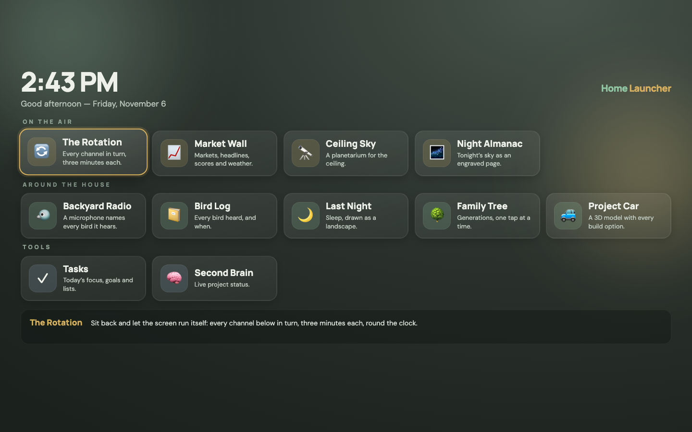

# Home App Launcher

One full-screen launcher for every app in my house. It runs on TVs, phones and laptops, and works with a TV remote, touch or a mouse.

I direct this work through Claude Code and own the design, testing and upkeep.

## What it does

- **Channels:** apps open inside the launcher, and Back returns to the lobby.
- **The Rotation:** plays each channel for three minutes, around the clock, so a TV can run unattended.
- **Auto-tune:** after five idle minutes it settles on a default channel. Any button press cancels.
- **Remote first:** arrow keys and OK work everywhere, because the main screen has no keyboard or mouse.
- **Responsive:** phones get a normal scrolling page, and large screens get a locked full-screen view.

Adding an app is one line in the `APPS` list.

## This version

The real apps are private, so each tile opens a placeholder in `channels/sample.html`. Open `index.html` in a browser to try it. No build step is needed.
